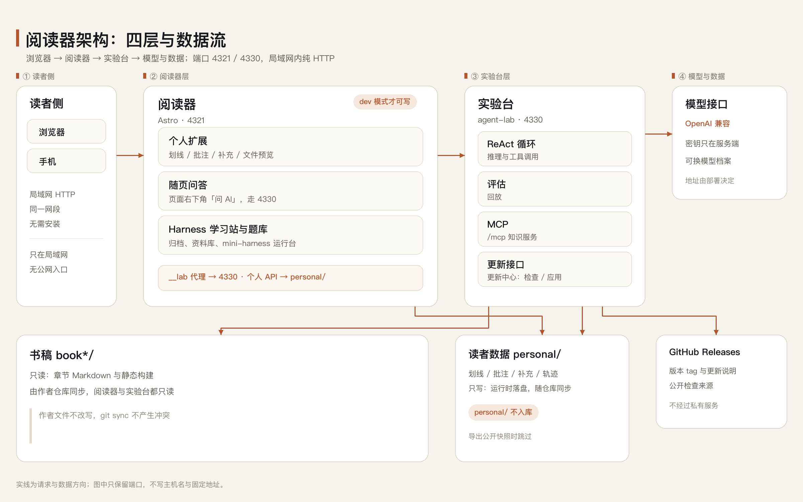
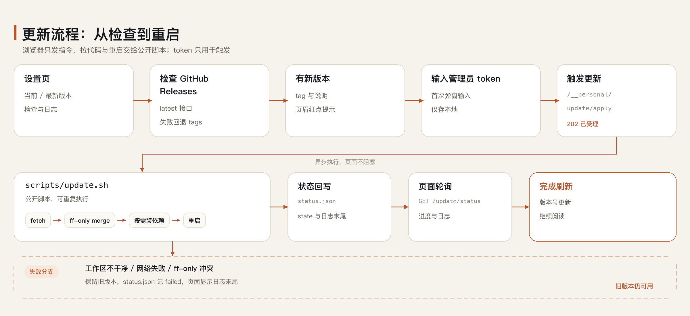

# AI Agent 阅读器扩展版：面向 AI 产品经理面试（非官方分支）


在《深入理解 AI Agent》官方 Astro 阅读器上加一层本地阅读环境：划线、批注、插入补充、随页问答、Harness 学习站与 Agent 实验台。书稿、笔记和模型密钥都留在自己的机器上。

**本分支主要面向 AI 产品经理的面试学习与准备**：把十章读成能复述的框架，用结业考试检查掌握度，用模拟面试练项目追问，再用简历、PRD 与产品拆解材料准备作品集表达。

> **非官方分支**
>
> 本仓库不是上游官方仓库，由读者基于 [bojieli/ai-agent-book](https://github.com/bojieli/ai-agent-book) 扩展而来，上游作者未参与本分支的开发与维护。
>
> 上游以 Apache-2.0 许可发布，Copyright 2025 Bojie Li；本分支沿用同一许可，继续分发书稿与阅读器，并以同一许可发布新增部分。
>
> 本分支对应的上游快照为 commit `dbc046eb896ac4e39aa19c7774c8bf49583b89a6`，逐目录归属见 [ATTRIBUTION.md](ATTRIBUTION.md)，版权声明见 [NOTICE](NOTICE)，可公开内容与风险清单见 [开源审计](docs/开源审计.md)。
>
> 与上游有关的问题不要提到上游仓库，上游也没有义务处理本分支的改动。

## 归属

| 类别 | 内容 | 维护与许可 |
|---|---|---|
| 原作者部分 | `book/`、`book-*/`（15 个语言版本的书稿与插图；chapter 实验链接指向上游）、`web-astro/src`、`web-astro/public`、`web-astro/scripts`、`assets/logo.svg` | Bojie Li，Apache-2.0；少量改动见 [ATTRIBUTION.md](ATTRIBUTION.md) |
| 本分支后加部分 | `web-astro/personal/`（读者扩展、Harness 站、题库、设置页、更新入口）、`agent-lab/`（书本助教、评估、MCP、随页问答后端）、`scripts/start.sh`、`scripts/update.sh`、`docs/`、根目录的 `README.md`、`AGENTS.md`、`NOTICE`、`ATTRIBUTION.md` | Eric-Ma-Q，Apache-2.0 |
| 本仓库不包含 | 作者的章节实验 `chapter*/`、幻灯片、多语言构建脚本、上游 CI 配置；读者数据 `personal/`、模型密钥、运行日志 | 不属于本分支的公开范围 |

## 为 AI 产品经理面试准备什么

| 阶段 | 用什么 | 怎么用 |
|---|---|---|
| 建立框架 | 十章正文、章节交互流程图、随页问答 | 先按章读一遍，再用「本章概念图」把章节压缩成可复述的结构；不懂的段落直接选中提问 |
| 检查掌握度 | 结业考试 A/B 卷、AI 产品经理题库 | 两套平行卷覆盖十章与七个部分；答题进度、成绩与错题本跨设备保留，错题回到原文 |
| 练表达与追问 | 模拟面试 | 按岗位画像做多轮问答，结束后生成复盘报告；题目和画像由自己填写，避免背模板 |
| 准备作品集 | 简历指南、报销审核 PRD、Claude Code 产品拆解、Harness 行业调研 | 用完整案例练「问题—判断—方案—取舍」的讲法，面试时能落到具体细节 |
| 补技术底 | 书本助教实验台、Harness 学习站 | 自己跑一遍 Agent 循环、工具调用与评估，回答「你怎么验证」时不空泛 |

这里不是面试题库堆砌：所有题目、复盘与案例都围绕书里的 Agent 设计原理，答案要能回到原文和工程细节。

## 功能

- **划线笔记与批注**：选中正文即可划线与写笔记，带彩色下划线的词句可弹出解释与来源，笔记按章节保存并跨设备共用。
- **插入补充**：在任意段落之后插入自己写的 Markdown 补充，支持公式与代码块，作者改写原文后仍能就近定位。
- **全部划线**：`/my-highlights/` 汇总所有章节的划线与笔记，可搜索、筛选、排序、原地编辑、导出 Markdown，并能跳回原文闪烁定位。
- **文件预览**：正文里出现仓库中真实存在的文件名时可直接点开预览，支持源码分段加载、查找、复制路径与下载，图片和 PDF 也能看。
- **随页问答**：任意页面右下角「问 AI」就当前页提问，回答可回原文、可生成概念图、可对概念类回答出题检验，也能回放这一轮的工具调用与用量。
- **Harness 学习站**：`/harness/` 按四个主题浏览 Harness 深读、产品拆解、AI 产品经理与行业调研，含资料库与两个可在浏览器里单步运行的模拟台。
- **题库与结业考试**：两套覆盖十章与七个部分的结业卷，答题进度、成绩与错题本存在本机并在设备间恢复，题库可收藏。
- **Agent 实验台**：`/lab/` 向书本助教提问，实时看到每一轮的上下文、token、缓存命中与工具调用，可做配置对比、跑评估、审批助教提交的补充。
- **模拟面试**：按 AI 产品经理岗位做多轮模拟面试并生成复盘报告，题目与画像由自己填写。
- **设置页**：`/settings/` 维护多套模型档案（接口、密钥、模型、推理档位、单价），实验台、随页问答与模拟面试共用同一份配置。
- **更新中心**：设置页显示当前版本与最新版本，有更新时页眉出现红点，可一键完成拉代码、按需装依赖，并按 `UPDATE_RESTART_CMD` 重启服务（前台运行时需手动重启）。

这些扩展只在开发模式（`astro dev`）下注入；`npm run build` 的静态产物与原版阅读器一致。

## 部署拓扑



图注：浏览器只访问阅读器的 4321 端口。阅读器自己提供 `/__personal`（笔记、划线、题库进度、更新）与 `/harness`（静态归档），并把 `/__lab` 反代到本机 4330 端口上的实验台；实验台再访问模型接口与可选工具。书稿来自 `book*/`，读者数据写在 `personal/`。

## 更新流程



图注：设置页检查 GitHub Releases，确认后调用服务端的更新接口，由 `scripts/update.sh` 以 fast-forward 方式拉取代码、只在锁文件变化时安装依赖、重启服务并回写状态；失败时保留日志与旧版本。

组件与请求流的细节见 [docs/架构.md](docs/架构.md)，长期运行与排障见 [docs/部署.md](docs/部署.md)。

## 快速开始

前置：Node >= 22.12、Python >= 3.12、[uv](https://docs.astral.sh/uv/)、macOS 或 Linux。Windows 未验证。

```bash
git clone https://github.com/Eric-Ma-Q/ai-agent-book.git
cd ai-agent-book

cd web-astro && npm ci && cd ..
cd agent-lab && uv sync --frozen && cd ..

cp agent-lab/.env.example agent-lab/.env
# 编辑 agent-lab/.env，填入 LAB_LLM_BASE_URL、LAB_LLM_API_KEY、LAB_MODEL

cp .env.example .env
# .env.example 已指向发布仓库；fork 到别处时改 UPDATE_REPO。再生成一键更新用的管理员 token
mkdir -p personal/update && openssl rand -hex 24 > personal/update/token && chmod 600 personal/update/token

bash scripts/start.sh
```

启动后打开 <http://127.0.0.1:4321/>。`scripts/start.sh` 默认只监听 `127.0.0.1`，阅读器在 4321、实验台在 4330；要让局域网里的手机访问，用 `bash scripts/start.sh --lan`，并注意同网段的人也能读写笔记接口。

第一次打开阅读器就可以看书；问答类功能需要先在 `/settings/` 添加模型档案（接口地址、密钥、模型 ID）。模型接口需兼容 OpenAI 的 `/v1/chat/completions`。

## 把这段发给 AI

把下面整段连同你的模型接口信息发给编码助手，它可以完成安装、配置与自检。更完整的版本（含验证清单与常见失败）见 [docs/AI部署.md](docs/AI部署.md)。

```text
在这台机器上部署「AI Agent 阅读器扩展版」，仓库地址：https://github.com/Eric-Ma-Q/ai-agent-book.git。
1. 检查 node -v（>= 22.12）、python3 -V（>= 3.12）、uv --version；缺依赖先告诉我，不要擅自改系统配置。
2. git clone https://github.com/Eric-Ma-Q/ai-agent-book.git，进入目录。
3. cd web-astro && npm ci；cd ../agent-lab && uv sync --frozen。
4. 由 agent-lab/.env.example 生成 agent-lab/.env，填入我给的 LAB_LLM_BASE_URL、LAB_LLM_API_KEY、LAB_MODEL；已有 .env 不要覆盖，先给我看差异。
5. 在仓库根前台运行 bash scripts/start.sh（阅读器 4321、实验台 4330，只监听 127.0.0.1）。
6. 健康检查 curl -sS http://127.0.0.1:4321/__lab/health，再打开 http://127.0.0.1:4321/ 与 /book/chapter1/ 确认能读。
7. 完成后告诉我访问地址、日志目录 run-logs/、管理员 token 位置 personal/update/token。
限制：不修改 book*/、chapter*/；不把密钥、.env、personal/ 下数据写进 git；不删除仓库之外的任何文件；失败先读 run-logs/ 再改。
```

## 更新

1. 打开 `/settings/`，在「项目更新」里点「检查更新」，看到新版本与更新说明；
2. 有更新时点「一键更新」，按提示输入管理员 token（首次更新后浏览器会记住），页面等待服务重启后自动刷新；
3. 命令行等价做法：`bash scripts/update.sh`。

重启由 `UPDATE_RESTART_CMD` 决定：用 LaunchAgent / systemd 时把它指向对应的重启命令，才算完整的「一键更新」；用 `scripts/start.sh` 前台运行时，更新会停在「请手动重启」，因为脚本不知道你的终端窗口。

版本号来自 GitHub Releases 的 tag（`vX.Y.Z`），更新说明即 Release 正文。更新只改代码与依赖，不触碰 `personal/` 下的任何数据。仓库地址未配置时该区块显示「未启用」，不影响阅读。

更新配置写在仓库根的 `.env`（`scripts/start.sh` 会读取）：

```bash
UPDATE_REPO=Eric-Ma-Q/ai-agent-book   # 发布仓库
UPDATE_BRANCH=main
# 可选：自定义重启命令；默认在 macOS 上尝试 launchctl kickstart
# UPDATE_RESTART_CMD='launchctl kickstart -k gui/501/com.example.reader'
```

更新中心默认从 `origin` 拉代码，`UPDATE_REPO` 只用于查 Release。若你的 `origin` 不是这个 GitHub 仓库，请把 `origin` 指到发布仓库，或改用命令行更新。

管理员 token 只存服务器本机（`personal/update/token`，权限 600），只用于确认这次更新是你发起的；它不参与 git，也不发给 GitHub。

## 目录结构

```text
.
├── book/ book-*/               原作者：15 种语言的书稿与插图
├── web-astro/
│   ├── src/ public/ scripts/   原作者：Astro 阅读器与图表脚本
│   ├── personal/               本分支：读者扩展、Harness 站、题库、设置页、更新入口
│   ├── astro.config.mjs        原作者为主，本分支只挂载 personal 集成
│   └── package.json            原作者为主，本分支加了 test:personal
├── agent-lab/                  本分支：书本助教、评估、MCP、随页问答后端
├── scripts/                    本分支：start.sh、update.sh
├── .env.example                本分支：端口与更新配置样例
├── docs/                       本分支：架构、部署、AI 部署提示词与架构图
├── assets/logo.svg             原作者
├── LICENSE NOTICE ATTRIBUTION.md AGENTS.md README.md
└── personal/                   运行时自动创建，不入库
```

## 数据与隐私

- `personal/` 是读者数据目录（划线、笔记、补充、批注、题库进度、实验台数据），首次运行时自动创建，已在 `.gitignore` 中排除。
- 模型密钥只存本机：`agent-lab/.env` 或 `personal/lab/models.keys.json`（权限 600），页面只显示「是否已填」，不回显、不入库。
- 没有遥测与统计上报。运行时只会访问你自己配置的模型接口、更新检查用的 GitHub API，以及可选的联网搜索与模型价格目录。
- 默认只监听 `127.0.0.1`，笔记接口不对局域网开放；用 `--lan` 暴露时请自行评估同网段的信任范围，接口本身没有账号体系。

## 许可与致谢

本仓库以 [Apache License 2.0](LICENSE) 发布，书稿与阅读器部分的版权归上游作者 Bojie Li（Copyright 2025），新增部分的版权归 Eric-Ma-Q。逐目录归属见 [ATTRIBUTION.md](ATTRIBUTION.md)。

使用到的开源项目：

- [Astro](https://astro.build/)：阅读器框架
- [KaTeX](https://katex.org/)、[remark-math](https://github.com/remarkjs/remark-math)、[rehype-katex](https://github.com/remarkjs/rehype-katex)：公式渲染
- [FastAPI](https://fastapi.tiangolo.com/)、[Uvicorn](https://www.uvicorn.org/)、[Pydantic](https://docs.pydantic.dev/)、[httpx](https://www.python-httpx.org/)、[PyYAML](https://pyyaml.org/)：实验台服务
- [trafilatura](https://trafilatura.readthedocs.io/)：网页正文提取
- [models.dev](https://models.dev/)：模型价格目录（只读公开数据）

书稿内容与插图由上游项目提供，本分支不改变其含义；发现内容问题请先对照上游仓库。
