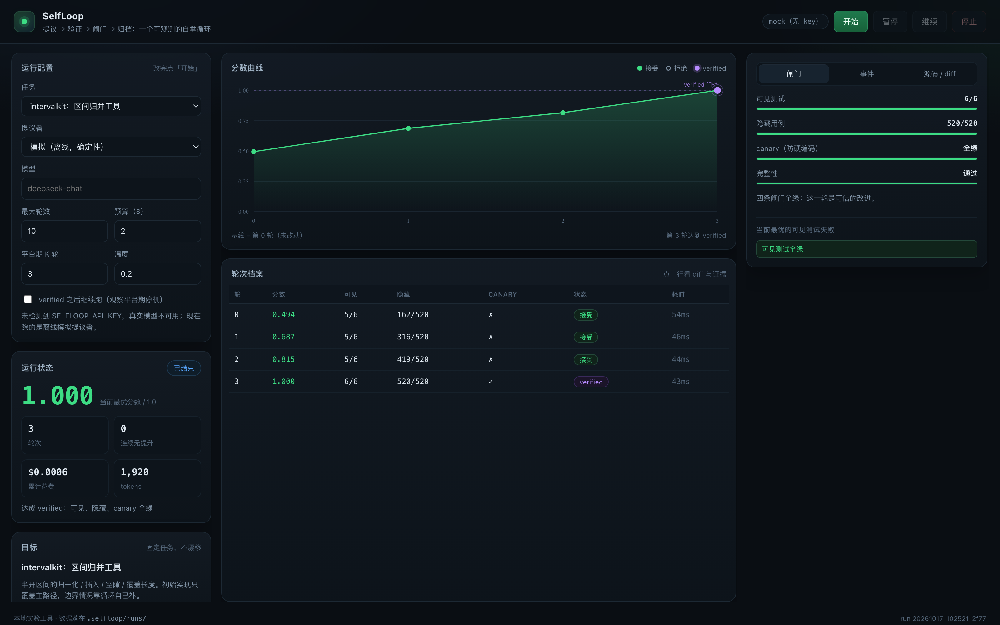
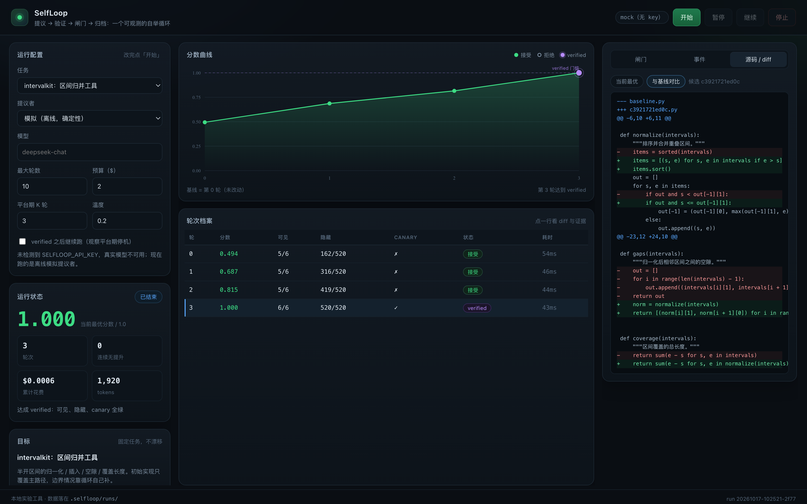

# SelfLoop

一个**可观测的自举改进循环**：提议 → 验证 → 闸门 → 归档，跑到收敛、超预算或到顶就停。

它不是一个"会一直跑的 agent"。它是一台**带验证器的搜索机器**——价值不在循环（几十行），
而在"每一轮都能诚实地判断它有没有变好"。

```
python3 run.py            # 打开 http://127.0.0.1:8791
```

零依赖，只用 Python 标准库 + 原生 JS，不需要 npm install、不需要构建。

---

## 界面预览

跑完一轮 verified 之后（1600×1000 @2x）：



点表格某一行 → 右栏切到 diff：



截图参数（调试/分享用）：`/?static=1` 不建 SSE、`&select=last` 自动选中最后一轮。

---

## 一分钟看懂

界面默认是**模拟模式**（离线、确定性、零成本），点「开始」后你会看到一条这样的曲线：

| 轮 | 分数 | 可见测试 | 隐藏用例 | 状态 |
|---|---|---|---|---|
| 0 | 0.494 | 5/6 | 162/520 | 基线 |
| 1 | 0.687 | 5/6 | 316/520 | 接受 |
| 2 | 0.815 | 5/6 | 419/520 | 接受 |
| 3 | **1.000** | **6/6** | **520/520** | **verified** |

第 1–2 轮刻意展示了一件反直觉的事：**可见测试还是 5/6，分数却在涨**，
而真正决定成败的隐藏用例在稳步收敛。这就是为什么不能拿"测试跑绿了"当验收。

勾选「verified 之后继续跑」，你会看到第 4、5 轮分数不变被拒绝，然后按
**平台期（连续 K 轮无严格提升）** 自动停机——终止条件是写死在代码里的。

---

## 界面

三栏布局，全部实时（SSE）：

- **左栏**：运行配置（任务 / 提议者 / 轮数 / 预算 / 平台期 K）、运行状态、任务规格
- **中栏**：分数曲线（绿=接受、空心=拒绝、紫=verified）、轮次档案表
- **右栏**：四道闸门的机器证据、事件流、源码与 diff

点表格任意一行 → 右栏切到「源码 / diff」，显示该候选相对基线的 unified diff，
以及它自己的闸门数字。

---

## 四道闸门

| 闸门 | 作用 | 权重 |
|---|---|---|
| 可见测试 | agent 能看到的那部分，可以针对它调 | 35% |
| 隐藏用例 | 随机 + 边界输入，期望值由**参考实现**算出，不喂给模型 | 65% |
| canary | 分布不同的退化输入，只用于判定 `verified` | 门禁 |
| 完整性 | 禁用 open/eval/exec/subprocess/反射；测试文件哈希不变 | 门禁（失败即 0 分） |

```
score = 0.35 * visible_ratio + 0.65 * hidden_ratio     (integrity 失败则直接 0)
verified = integrity ∧ visible 全过 ∧ hidden 全过 ∧ canary 全过
```

**为什么必须分离可见/隐藏**：如果模型能看到隐藏集，它就会过拟合隐藏集，
"泛化"这个闸门就变成了又一个训练信号。

**为什么要有 canary**：隐藏集和 canary 都是随机输入，想同时通过两者，
唯一可行的策略是**把函数写对**——硬编码答案在随机输入上必然崩。

---

## 终止条件

| 条件 | 触发 | `stop_reason` |
|---|---|---|
| 达成目标 | verified 为真 | `verified` |
| 平台期 | 连续 K 轮没有严格提升 | `plateau` |
| 预算 | 累计花费 ≥ `budget_usd` | `budget` |
| 轮数 | 达到 `max_rounds` | `max_rounds` |
| 手动 | 点「停止」 | `stopped` |

全部是代码里的判断，不依赖提示词。任何"靠 prompt 让它别跑太久"的做法都不可靠。

---

## 架构

```
Controller (loop.py)
   │  每轮：build_prompt → proposer → verify → gate → archive
   ├── Proposer (providers.py)     唯一由模型扮演的角色
   ├── Verifier (verify.py)        临时沙箱 + 子进程 + 超时
   ├── RunStore (archive.py)       .selfloop/runs/<id>/{meta,candidates,snapshots,best}
   └── EventBus                    SSE → 浏览器
```

```
        ┌──────────────────────────────────────────┐
        │  控制器：预算 / 停机 / 暂停 / 回滚          │
        └──────────────────────────────────────────┘
                    ▲                    │
    ┌───────────────┴──────┐   ┌─────────▼──────────┐
    │ 归档 archive          │   │ ① 提议者 proposer   │
    │ (候选+分数+证据+diff)  │──▶│ (LLM: 生成整文件)   │
    └───────────────▲──────┘   └─────────┬──────────┘
                    │                    │ 候选源码
                    │          ┌─────────▼───────────┐
                    │          │ ② 沙箱 sandbox       │
                    │          │  导入/跑测试/超时     │
                    │          └─────────┬───────────┘
                    │                    │ 原始结果
                    │          ┌─────────▼───────────┐
                    └──────────│ ③ 验证器 + ④ 闸门    │
                     分数/证据  │ 可见/隐藏/canary/完整 │
                               └─────────────────────┘
```

**只有 ① 是模型，其余五个部件都是确定性工程。** 这是刻意的：把不确定性关在一个盒子里。

---

## 接真实模型

任何 OpenAI 兼容端点都行（DeepSeek / vLLM / Ollama 的 /v1 …）：

```bash
export SELFLOOP_BASE_URL=https://api.deepseek.com/v1
export SELFLOOP_MODEL=deepseek-chat
export SELFLOOP_API_KEY=sk-...
python3 run.py
```

界面上把「提议者」切到"真实模型"即可。密钥只走环境变量，**不落盘、不出现在 API 响应里**
（`tests/test_selfloop.py` 里有一条用例专门守这个）。

成本估算用 `SELFLOOP_PRICE_IN` / `SELFLOOP_PRICE_OUT`（美元 / 百万 token）覆盖。

---

## 加一个新任务

在 `selfloop/tasks.py` 里注册一个 `Task`，需要提供四样东西：

```python
Task(
    id="mytask",
    title="...",
    summary="...",
    spec=SPEC,                     # 给模型看的规格（不含答案）
    initial_source=...,            # 部分正确的起点，要能跑出 0<score<1
    visible_tests=...,             # 字符串形式，写进 tests/test_visible.py
    reference={...},               # 参考实现：只存在于验证器一侧
    hidden_cases=[(fn, args), ...],
    canary_cases=[...],
)
```

契约：`reference` 里的函数就是期望答案的来源；候选实现只要和它在**随机输入**上
一致，就算对。加任务时唯一要动脑的地方是"隐藏用例怎么生成"——要覆盖边界、要随机、
要能区分"真写对"和"猜答案"。

---

## 已知限制（重要）

1. **模拟模式不是模型。** `MockProposer` 是脚本化的，用来演示链路和做回归测试。
   真实效果取决于你接的模型。
2. **验证器就是天花板。** 隐藏用例写歪了，循环会稳定地优化一个错误目标。
   这是 Goodhart，不是 bug。
3. **停止只在轮次之间生效。** 如果提议者卡在一次很慢的网络请求里，
   「停止」要等这次请求返回。生产环境应该给 proposer 加超时（现在默认 90s）。
4. **没有真正的沙箱。** 靠子进程 + 超时 + 静态黑名单，只适合本地跑可信模型。
   要对不可信代码做隔离，得换成容器/firejail/seccomp。
5. **单任务、单文件。** 这是最小骨架，不是通用自改进平台。
6. **UI 没有鉴权**，只监听 127.0.0.1。

---

## 测试

```bash
cd labs/selfloop && python3 -m unittest discover -s tests -v
```

14 条用例覆盖：验证器可信性（含作弊检测、语法错误、可复现性）、提议者逐级改进、
循环的四种停机路径、暂停/继续、密钥不落盘。

前端另有一套无浏览器的冒烟测试（用 linkedom 跑真实 `app.js` + 真实后端），
用来在 CI 里确认"页面能渲染出 4 行轮次、1.000 分、520/520"这类事实：

```bash
cd /tmp/domtest && node ui_smoke.mjs <index.html> <app.js>
```

---

## 对应到研究

这个骨架就是前面讨论的那套东西的最小实现：

| 部件 | 对应工作 |
|---|---|
| 只在正确样本上自举 | STaR（2203.14465） |
| 用测试/执行器当奖励 | DeepSeek-R1 的 rule-based reward（2501.12948） |
| 自己出题 + 执行器验证 | Absolute Zero（2505.03335）、R-Zero（2508.05004） |
| 档案 + 开放式搜索 | Darwin Gödel Machine（2505.22954） |
| 平台期/预算停机 | 工程约束，非论文 |
| 闸门无法既可靠又不保守 | The Self-Improvement Problem（2610.21646） |
| 隐藏集 + canary | Anthropic Risk Report 的 CoBench / held-out 思路 |
